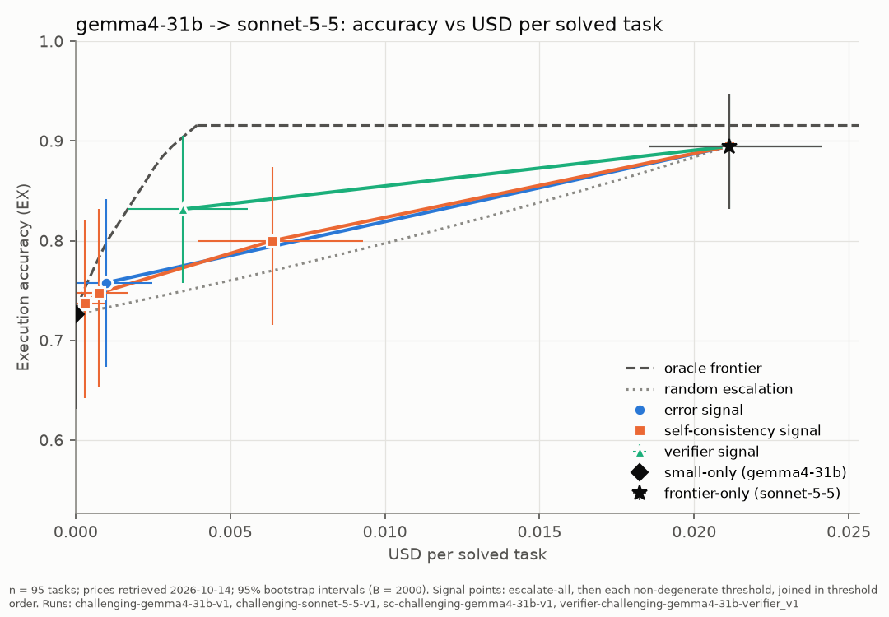

# Escalator

Cost-aware escalation routing for a data-analysis agent.

This repo builds a text to SQL agent that is evaluated on a task set, with several models acting as its brain: small local models and paid online models.

The task the agent is evaluated on are drawn from **ReViSQL** — Zhu, Jin, Choi, Kang, arXiv:2603.20004, 2026. We are using their corrected version of Mini-BIRD-Dev, i.e. Arcwise-Plat-Full

The goal is to study an escalation policy over different error signals, and compute the cost vs accuracy curve for different thresholds of these error signals.

## Results

### Escalation from gemma4-12b to sonnet-5.5

Results with gemma4-12b as the baseline model and sonnet-5.5 as the frontier model (effort: medium)

Two error signals are strong candidates for reducing costs: verifier (green) and self-consistency at τ=0 (orange). Signals are defined in the methodology (not added yet) but a short description is provided for context at the end of this paragraph in the notes.

 

- The routed protocol with verifier signal reaches 84% accuracy vs 86% accuracy for the frontier model but **at a 2.4× lower cost per solved task**.
- The routed protocol with self-consistency signal at τ=0 reaches 83% accuracy vs 86% accuracy for the frontier model but **at a 3× lower cost per solved task**.
- An oracle router over the same recorded outcomes reaches **89.5%** at matched cost, so the realizable verifier signal captures 73% of the available routing gain, while self-consistency capture 68% of the realizable routing gain.

 
Execution accuracy vs USD per solved task:
 

 

Paired tests (McNemar - with Holm correction for the routed signals) for the verifier signal:

- **Routed vs gemma4-12b alone:** McNemar's p value: 2.3 × 10⁻⁷. Routing beats the small model by 15.0 pp.
- **Routed vs frontier alone:** McNemar's p value: 0.39 (Holm 1.0). No significant difference is detectable from this experiment

### Escalation from gemma4-31b to sonnet-5.5

Results with gemma4-31b as the baseline model and sonnet-5.5 as the frontier model (effort: medium)

**On the 200 tasks draw from Arcwise-Plat-Full, there is no evidence that an escalation policy from gemma4-31b to sonnet-5.5 shows a significative increase in accuracy** The baseline gemma4-31b achieves 81.5% accuracy, and the frontier model 86%. The routed policy with the verifier signal achieves 83.5% accuracy, so a +2pp gain but not statistically significant as per McNemar's test.

**However when split per difficulty strata, the escalation policy seems to show higher gains with gemma4-31b on the "challenging" strata:**

| Stratum | n | EX 31b alone % [CI] | `verifier` τ = 0: EX % [CI] / Δ pp / esc. / p (Holm) | frontier only: EX % [CI] / Δ pp / p (Holm) |
|---|---|---|---|---|
| simple | 61 | 91.8 [82.2, 96.4] | 90.2 [80.2, 95.4] / −1.6 / 0 / 1.00 (1.00) | 91.8 [82.2, 96.4] / +0.0 / 2 / 2 / 1.00 (1.00) |
| moderate | 100 | 80.0 [71.1, 86.7] | 82.0 [73.3, 88.3] / +2.0 / 4 / 0.69 (1.00) | 85.0 [76.7, 90.7] / +5.0 / 8 / 13 / 0.38 (0.87) |
| challenging | 39 | 69.2 [53.6, 81.4] | 76.9 [61.7, 87.4] / +7.7 / 3 / 0.25 (0.75) | 79.5 [64.5, 89.2] / +10.3 / 2 / 6 / 0.29 (0.87) |

Although the p value is still not significant for the challenging strata, the support is very small. 

**We ran the gemma4-31b to sonnet-5.5 escalation policy over all the 95 challenging tasks in Arcwise-PLat-Full, and found significant gains from the escalation policy: On the verifier signal, the escalation policy achieves +10.5pp in accuracy (p=0.002, holm=0.0039) at a 6.1× lower cost per solved task**

 
Execution accuracy vs USD per solved task on the 95 tasks from the "challenging" strata:
 

 

### Notes and limitations

*Notes:*

- Verifier signal: The verifier signal tests the equality of the submitted query result between the model and the same model that is given a reformulated prompt. Failure to agree triggers the escalation. The signals tested are described in the methodology section.
- self-consistency at τ=0: self-consistency is computed as the self agreement between k repeated runs at temperature t (here k=3, t=0.7). τ=0 means all runs should produce the same result, otherwise the signal is routed. It is the most restrictive setting for self-consistency.
- Costs are API USD at prices retrieved on 2026-10-14; the local models are priced at $0, assuming the infrastructure that runs them exists and ingoring electricity cost, which can be discussed.

*Limitations:*

- All models are given the same prompt, that is kept very simple ([v1 prompt](src/escalator/agent/prompts/v1.yaml)). The goal was not to optimize the SQL accuracy of the agent, but to compare the models on the escalation routine. So the accuracy numbers are not benchmarks, and better results should be expected with a prompt optimized for each model.

## Reproduce

WIP

## Documentation

- Statistical protocol (WIP)
- Architecture: [Architecture.md](docs/architecture.md)

## Related work

- Jin et al. - [Pervasive Annotation Errors Break Text-to-SQL Benchmarks and
Leaderboards](https://arxiv.org/pdf/2601.08778v3)
- Li et al. — [Can LLM Already Serve as A Database Interface?
A BIg Bench for Large-Scale Database Grounded
Text-to-SQLs](https://arxiv.org/pdf/2305.03111)
