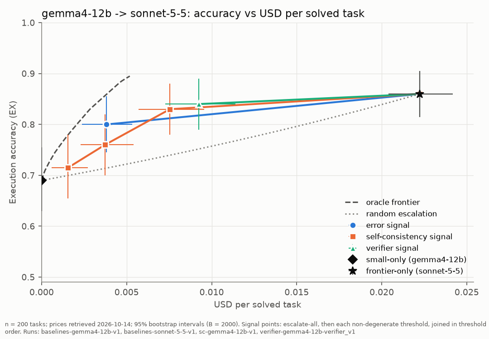

# Escalator

>[Work in progress: geamma4-31b to sonnet-5.5 escalation on challenging task is being studied]

Cost-aware escalation routing for a data-analysis agent.

This repo builds a text to SQL agent that is evaluated on a task set, with several models acting as its brain: small local models and paid online models.

The task the agent is evaluated on are drawn from **ReViSQL** — Zhu, Jin, Choi, Kang, arXiv:2603.20004, 2026. We are usin their corrected version of Mini-BIRD-Dev, i.e. Arcwise-Plat-Full

The goal is to study an escalation policy over different error signals, and compute the cost vs accuracy curve for different threshold of these error signals.

## Result

Results are presented with gemma4-12b as the baseline model and sonnet-5.5 as the frontier model (effort: medium)

Two error signals are strong candidates for reducing costs: verifier (green) and self-consistency at τ=0 (orange). Signals are defined in the methodoliogy but a short description is provided for context at the end of this paragraph in the notes.

 

- The routed protocol with verifier signal reaches 84% accuracy vs 86% accuracy for the frontier model but **at a 2.4× lower cost per solved task**.
- The routed protocol with self-consistency signal at τ=0 reaches 83% accuracy vs 86% accuracy for the frontier model but **at a 3× lower cost per solved task**.
- An oracle router over the same recorded outcomes reaches **89.5%** at matched cost, so the realizable verifier signal captures 73% of the available routing gain, while self-consistency capture 68% of the ralizable routing gain.

 
Execution accuracy vs USD per solved task:
 

 

Paired tests (McNemar) for the verifier signal:

- **Routed vs gemma4-12b alone:** McNemar's p value: 2.3 × 10⁻⁷. Routing beats the small model by 15.0 pp.
- **Routed vs frontier alone:** McNemar's p value: 0.39. No significant difference is detectable from this experiment

*Notes:*

- Verifier signal: The verifier signal tests the equality of the submitted query result between the model and the same model that is given a reformulated prompt. Failure to agree triggers the escalation. The signals tested are described in the methodology section.
- self-consistency at τ=0: self-consistency is computed as the self agreement between k repeated runs at temperature t (here k=3, t=0.7). τ=0 means all runs should produce the same result, otherwise the signal is routed. It is the most restrictive setting for self-consistency.
- Costs are API USD at prices retrieved on 2026-10-14; the local models are priced at $0, assuming the infrastructure that runs them exists, which can be discussed.

*Limitations:*

- With gemma4-31b as the base model, the escalation gain is not significant (+2pp, McNemar not significant). There is very few settings where one could use gemma4-12b but not gemma4-31b as its base model and apply the escalation routine, so this makes the results presented here not very useful. We started studying the escalation gain from gemma4-31b to frontier model (sonnet + Opus) on the full `difficult` strata of Arcwise-Plat-Full, to see if such an escalation policy would bring value.
- All models see the same prompt, that is kept simple. Te goal was not to optimize the SQL accuracy of the agent, but to compare the models on the escalation routine. So the accuracy numbers are not benchmarks, and better results should be expected with a prompt optimized for each model.
